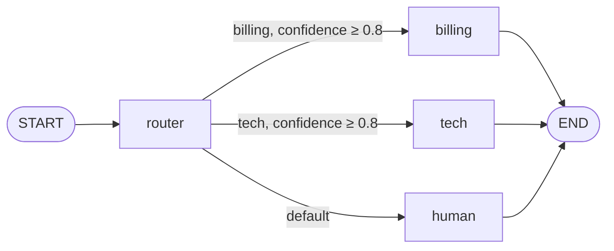
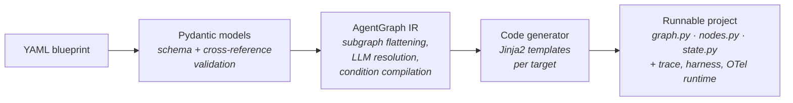
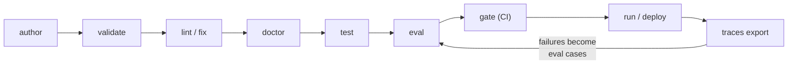

<div align="center">

# agent-blueprint

### Declarative AI agent orchestration with runtime guarantees.

Describe your agent system in one YAML blueprint.<br/>
Get a runnable LangGraph project where **every contract, policy and budget you declared is enforced at runtime**,<br/>
and comes with tests, a CI gate and traces.

[](https://pypi.org/project/agent-blueprint/)
[](https://pypi.org/project/agent-blueprint/)
[](https://github.com/ahmetatar/agent-blueprint/actions/workflows/ci.yml)
[](LICENSE)

[**Quick start**](#quick-start) · [**Why ABP**](#why-abp) · [**How it works**](#how-it-works) · [**Schema**](#blueprint-schema) · [**CLI**](#cli-reference) · [**Docs**](docs/)

<br/>


<sub>A one-line routing change, caught before merge. Fully offline: mocked LLM, stubbed tools, no API key. Source: <a href="docs/assets/gate-demo/"><code>docs/assets/gate-demo/</code></a></sub>

</div>

<br/>

```bash
pip install agent-blueprint
abp init --output my-agent.agents.yaml
abp run my-agent.agents.yaml "Hello!"
```

---

## A blueprint in 60 seconds

This is the blueprint from the demo above, trimmed. A router classifies a ticket, and conditional edges send it to the right specialist:

```yaml
contracts:
  nodes:
    router:
      produces: [route, confidence]
      output_contract: triage            # router output is validated against this schema

graph:
  entry_point: router
  nodes:
    router:  { agent: router }
    billing: { agent: billing }
    tech:    { agent: tech }
    human:   { agent: human }
  edges:
    - from: router
      to:
        - target: billing
          condition: "state.route == 'billing' and state.confidence >= 0.8"
        - target: tech
          condition: "state.route == 'tech' and state.confidence >= 0.8"
        - default: human                 # anything uncertain goes to a person

harness:
  scenarios:
    - id: refund_request
      input: { message: "Please refund invoice 123" }
      expected: { route: billing, tools_called: [issue_refund] }
```

`abp inspect` turns it into a graph:



Then a teammate tightens one threshold:

```diff
-          condition: "state.route == 'billing' and state.confidence >= 0.8"
+          condition: "state.route == 'billing' and state.confidence >= 0.9"
```

And `abp gate` blocks the merge, with no LLM call and no API key:

```console
$ abp gate support.yml
FAIL scenario 'refund_request': tools_called mismatch: expected ['issue_refund'], got [];
     route mismatch: expected 'billing', ended on 'human'
Regressions:
  - scenario 'refund_request' regressed: passed -> failed
Gate FAILED                                                    # exit code 1
```

---

## Why ABP

Most agent frameworks let you *describe* guardrails. ABP **compiles them into the generated code**, so the contract in YAML and the behavior in production cannot drift apart.

| You declare | The generated runtime does |
|---|---|
| `contracts.state.invariants` | Re-checks every invariant after each agent and supervisor node. A violation emits a `contract_failed` trace event, then raises |
| `contracts.nodes.*.output_contract` | Validates the node's structured output against your JSON-schema-style contract |
| `policies.approvals` | Puts the listed tool calls behind human approval. `block` raises; `warn` continues but records a `policy_violation` event |
| `policies.tool_usage` | Counts and caps tool calls per node and per run. A violation stops the run, and unknown tools fail instead of silently passing through |
| `agents.*.max_turns` | Caps the LLM calls in a node's tool loop. At the limit it emits `max_turns_exhausted` and fails or finishes the node |
| `policies.budgets` | Meters real token usage and provider-priced cost on every LLM call. Crossing `max_tokens_per_run` / `max_cost_usd` aborts the run mid-flight; `max_latency_seconds` is checked at completion |
| `policies.escalation` | Reroutes to your review/handoff node the moment confidence drops below the threshold: mid-run, not after the fact |
| `graph.nodes.*.retry` | Retries with backoff and emits retry trace events. Exhausted retries fail deterministically |
| `harness.scenarios` | Runs as deterministic tests (mocked LLM, stubbed tools, seeded). No API key, no flakiness, ready for CI |

Every enforcement emits a structured trace event. That makes the same declarations **observable** (OpenTelemetry export), **testable** (`abp test` asserts on routes, state and artifacts) and **gateable** (`abp gate` fails the PR when behavior regresses against the baseline).

### The blueprint is the review unit

> [!IMPORTANT]
> **When agents write the code, humans review the design.**
> A multi-agent system generated as thousands of lines of Python can't really be reviewed. A blueprint can, and ABP keeps it honest: everything it declares is enforced at runtime.

Reviewing generated code means rebuilding the design from its implementation. Reviewing a blueprint means reading the design directly:

| The question every reviewer asks | In generated code | In the blueprint |
|---|---|---|
| Is this loop bounded? | Inferred from edges spread across `graph.py` | `max_iterations`, `max_turns`, plus the `unbounded-loop` lint |
| Who approves this tool call? | Wrapper logic inside `nodes.py` | `policies.approvals` |
| What must this node return? | Validation code, if anyone wrote it | `contracts.nodes.*.output_contract` |
| Where does control go when confidence drops? | Router functions and state flags | `policies.escalation` |
| What does this change actually change? | A 3,000-line diff | A 5-line YAML diff |

The blueprint becomes the **contract between the human and the agent**. The agent can generate, refactor and regenerate the implementation as often as it likes; the human reviews the part that carries the decisions. The schema is deliberately narrow, which also limits how much an agent can get wrong.

> [!NOTE]
> **The YAML can't lie.** A short blueprint whose guarantees aren't enforced is worse than reading the code, because it gives you false confidence. So every declaration compiles to runtime enforcement, emits a trace event, and is pinned by `abp test` and `abp gate`.
> Mind the scope: the blueprint describes **structure and guarantees**. Whether the agents *behave well* is a question for evals and traces. Blueprint + evals + traces is the full picture. See [ADR 0001](docs/adr/0001-blueprint-is-the-source-of-truth.md).

For a one-off demo, handwritten code is fine. For agent systems that need consistency, auditability and repeatable delivery across a team, ABP is the stronger foundation.

---

## How it works

A blueprint flows through a strict, one-way compilation pipeline:



Conditions like `state.department == 'billing'` are parsed by a safe AST-based parser: no `eval`, no arbitrary code. The same parser powers static analysis, such as route-overlap detection and loop analysis in the linter.

### The operational lifecycle

The real value comes after generation. A blueprint lives in this loop:



| Surface | What it does |
|---|---|
| `abp lint` / `abp fix` | 11 static checks over the compiled graph (unreachable nodes, route overlap, unbounded loops, parallel branch conflicts and more); 2 are auto-fixable |
| `abp doctor` | Environment and target-compatibility diagnostics before you generate |
| `abp test` | Deterministic harness: mock/replay/live LLM, stub/replay/live tools, route/state/artifact/output-contract assertions |
| `abp eval` | Dataset-driven eval suites (`exact_match`, `policy_violations`, `rubric`) |
| `abp gate` | CI merge gate: runs harness + evals, diffs against a committed baseline, exit 1 on regression |
| `abp traces` | Persisted trace records. Export failures (or goldens) as eval cases: the dataset grows from real failures |
| `abp run` | Generates to a temp dir and executes, optionally in a docker/podman sandbox with an allowlist-only environment |
| `abp package` | Packages the agent as a pip/pipx-installable command-line tool |
| `abp deploy` | Builds a container and runs it locally with Docker/Podman, or ships it to Azure Container Apps, AWS App Runner or GCP Cloud Run (cloud platforms experimental) |

**Observability is declarative too.** A top-level `observability.tracing` section exports trace events as OpenTelemetry spans to any OTLP backend. Only hashes are exported, never message content. Standard `OTEL_*` env vars override blueprint values, and `ABP_OTEL=off` is the kill switch.

Deep dives: [Runtime Guarantees](docs/runtime-guarantees.md) · [Gate](docs/gate.md) · [Traces](docs/traces.md) · [Sandbox](docs/sandbox.md) · [Observability](docs/observability.md) · [Scope](docs/scope.md)

---

## Quick start

**Requirements:** Python 3.11+

```bash
pipx install agent-blueprint     # recommended: keeps abp isolated
# or: pip install agent-blueprint
```

**1. Create a blueprint**

```bash
abp init --template=blueprint --output=my-agent.agents.yaml
# or scaffold a markdown request template for Codex / Claude Code:
abp init --template=spec --output=my-agent.spec.md
```

<details>
<summary>The generated <code>my-agent.agents.yaml</code></summary>

```yaml
blueprint:
  name: "my-agent"
  version: "1.0"
  description: "A simple single-agent blueprint"

settings:
  default_model: "gpt-4o"
  default_temperature: 0.7

state:
  fields:
    messages:
      type: "list[message]"
      reducer: append

agents:
  assistant:
    model: "${settings.default_model}"
    system_prompt: |
      You are a helpful assistant.

graph:
  entry_point: assistant
  nodes:
    assistant:
      agent: assistant
      description: "Main assistant node"
  edges:
    - from: assistant
      to: END

memory:
  backend: in_memory
```

</details>

**2. Check it**

```bash
abp validate my-agent.agents.yaml    # schema + cross-reference validation
abp lint     my-agent.agents.yaml    # static analysis on the compiled graph
abp doctor   my-agent.agents.yaml    # env vars set? impls importable? target compatible?
abp inspect  my-agent.agents.yaml    # Mermaid diagram of the graph
```

**3. Run it**

```bash
# the short way: generate to a temp dir and execute
abp run my-agent.agents.yaml "Hello, how are you?"

# isolated from the host: container image + allowlist-only environment
abp run my-agent.agents.yaml "Hello, how are you?" --sandbox
```

**4. Or own the code**

```bash
abp generate my-agent.agents.yaml --target langgraph
cd my-agent-langgraph
pip install -r requirements.txt
cp .env.example .env                 # add your OPENAI_API_KEY
python main.py "Hello, how are you?"
```

The generated code is plain, readable LangGraph. Edit it freely, or stay blueprint-first and regenerate safely.

---

## Blueprint schema

| Section | Required | Description |
|---|:---:|---|
| `blueprint` | ✅ | Name, version, description |
| `settings` | | Default model, temperature, retries, `max_graph_steps` |
| `state` | | Shared typed state fields flowing through the graph |
| `model_providers` | | OpenAI, Anthropic, Google, Ollama, Azure, Bedrock, compatible endpoints ([details](docs/model-providers.md)) |
| `retrievers` | | Generic RAG retriever implementations ([details](docs/rag.md)) |
| `mcp_servers` | | MCP server connections. Schema-validated; generation not implemented yet ([details](docs/mcp-servers.md)) |
| `agents` | ✅ | Agent definitions: model, prompt, tools, memory, RAG, reasoning |
| `tools` | | `function`, `api`, `retrieval`, `mcp` ([details](docs/tools.md)) |
| `graph` | ✅ | Nodes, edges, entry point. Includes parallel, subgraph, handoff and supervisor nodes ([details](docs/workflow-nodes.md)) |
| `subgraphs` | | Named reusable graphs referenced by `subgraph` nodes (nesting supported) |
| `memory` | | Checkpointing / persistence ([details](docs/memory.md)) |
| `input` / `output` | | Input/output schemas, validated at runtime |
| `contracts` | | State, node and output contracts. **Enforced at runtime** |
| `policies` | | Approvals, tool limits, budgets, low-confidence escalation. **Enforced at runtime** |
| `artifacts` | | Declared artifacts (markdown/json/yaml/text) with producer + contract binding |
| `harness` | | Deterministic scenario tests and replay fixtures |
| `evals` | | Dataset-driven eval suites |
| `run` | | Sandbox configuration for `abp run` ([details](docs/sandbox.md)) |
| `observability` | | OpenTelemetry trace export ([details](docs/observability.md)) |
| `deploy` | | Cloud deployment configuration ([details](docs/deploy.md)) |

Click a section to expand it:

<details>
<summary><b><code>blueprint</code> and <code>settings</code></b>: identity and defaults</summary>

```yaml
blueprint:
  name: "my-agent"       # Required. Used for naming generated files.
  version: "1.0"         # Optional. Default: "1.0"
  description: "..."     # Optional.
  author: "..."          # Optional.
  tags: [support, nlp]   # Optional.

settings:
  default_model: "gpt-4o"             # Default model for all agents
  default_model_provider: openai_gpt  # Default provider (references model_providers)
  default_temperature: 0.7
  max_retries: 3
  timeout_seconds: 300
  max_graph_steps: 25                 # maps to LangGraph recursion_limit
```

**Variable interpolation** supports two namespaces:

- `${settings.field}`: resolved from the blueprint's `settings` section
- `${env.VAR_NAME}`: resolved from environment variables at load time. If the variable is not set, the placeholder is kept as-is

</details>

<details>
<summary><b><code>state</code></b>: the typed state shared across nodes</summary>

```yaml
state:
  fields:
    messages:
      type: "list[message]"   # Built-in message list type
      reducer: append          # How concurrent updates merge: append | replace | merge
    department:
      type: string
      default: null
      enum: [billing, technical, general]
    resolved:
      type: boolean
      default: false
```

Reducers matter for parallel nodes: fan-out branches merge their updates through the declared reducer.

</details>

<details>
<summary><b><code>agents</code></b>: model, prompt, tools, memory, reasoning</summary>

```yaml
agents:
  my_agent:
    name: "Friendly Name"           # Optional display name
    model: "gpt-4o"                 # or ${settings.default_model}
    model_provider: openai_gpt      # References model_providers
    system_prompt: |
      You are a helpful assistant.
    tools: [tool_a, tool_b]         # References to tools section
    temperature: 0.5
    max_tokens: 2048
    max_turns: 6                    # cap on LLM calls in this node's tool loop
    memory:
      type: conversation_buffer     # conversation_buffer | summary | vector
      max_tokens: 4000
    human_in_the_loop:
      enabled: true
      trigger: before_tool_call     # before_tool_call | after_tool_call | before_response | always
      tools: [dangerous_tool]       # Only require approval for specific tools
    llm_params:                     # Optional raw kwargs for the LangChain chat class
      timeout: 60
    reasoning:
      enabled: true                 # Mark this as a native reasoning/thinking agent
      params:                       # Raw kwargs passed through to the selected adapter
        reasoning:
          effort: high
```

See [Model Providers](docs/model-providers.md) for adapter selection and [Reasoning Patterns](docs/reasoning.md) for native thinking and graph-level reasoning strategies. Structured outputs belong under top-level `contracts` and `output`, not under agents.

</details>

<details>
<summary><b><code>tools</code></b>: function, api, retrieval, mcp</summary>

```yaml
tools:
  classify_intent:
    type: function
    impl: "myapp.classifiers.classify_intent"   # optional: wire existing code
    description: "Classify customer intent"
    parameters:
      message:
        type: string
        required: true

  lookup_invoice:
    type: api
    method: GET
    url: "https://api.example.com/invoices/{invoice_id}"
    auth:
      type: bearer
      token_env: "BILLING_API_KEY"
```

`mcp` tools are schema-only today (see [status](docs/mcp-servers.md)). See [Tools](docs/tools.md) for all tool types and [RAG](docs/rag.md) for retrievers and automatic context injection.

</details>

<details>
<summary><b><code>graph</code> and <code>subgraphs</code></b>: six node types and conditional routing</summary>

Node types: `agent` (default), `function`, `handoff`, `parallel`, `subgraph` and `supervisor`.

```yaml
graph:
  entry_point: router

  nodes:
    router:
      agent: router
      description: "Route requests"
      retry:
        max_attempts: 2
        backoff_seconds: 1
        on: [exception]
    handle_billing:
      agent: billing_agent
    escalate:
      type: handoff
      channel: slack            # console | webhook | slack | email
    fan_out_context:
      type: parallel
      branches: [research, pricing]
      join: merge_context
    triage:
      type: supervisor
      workers: [research, pricing]   # dynamic delegation via generated transfer tools
      max_iterations: 8
      on_finish: END
    prd_pipeline:
      type: subgraph
      ref: prd_generation_v1
      input_map:
        messages: messages
      output_map:
        prd: prd

  edges:
    - from: handle_billing          # simple edge
      to: END

    - from: router                  # conditional routing
      to:
        - condition: "state.department == 'billing'"
          target: handle_billing
        - condition: "state.department == 'technical'"
          target: handle_technical
        - default: END

subgraphs:
  prd_generation_v1:
    entry_point: writer
    nodes:
      writer:
        agent: prd_writer
    edges:
      - from: writer
        to: END
```

| Node type | Behavior |
|---|---|
| `parallel` | Fans out to each branch and joins at the declared `join` node, a real barrier. Branch updates merge through the state reducers |
| `subgraph` | Reuses a named graph with namespaced isolation. Nesting supported, cycles detected at compile time |
| `supervisor` | Delegates dynamically to a declared worker set, with an enforced iteration budget |
| `handoff` | Delivers to console/webhook/slack/email and emits `handoff_requested` events |

**Condition expressions** support `==`, `!=`, `<`, `>`, `<=`, `>=`, `in`, `not in`, `and`, `or`, `not`, and reference state with `state.field_name`. Arbitrary names, function calls, arithmetic and subscripts are rejected. See [Condition Expressions](docs/condition-expressions.md) and [Workflow Nodes](docs/workflow-nodes.md).

</details>

<details>
<summary><b><code>contracts</code></b>: state, node and output contracts</summary>

```yaml
contracts:
  state:
    required_fields: [messages]
    immutable_fields: [request_id]
    invariants:
      - "state.confidence >= 0"

  nodes:
    router:
      requires: [messages]
      produces: [route, confidence]
      output_contract: route_payload

  outputs:
    route_payload:
      type: object
      required: [route, confidence]
      properties:
        route: { type: string }
        confidence: { type: number }
```

Every contract layer is enforced by the generated code: `required_fields` must be non-null when the workflow completes, `invariants` are re-checked after every agent and supervisor node, and violations emit `contract_failed` trace events before raising.

</details>

<details>
<summary><b><code>policies</code></b>: approvals, tool limits, escalation, budgets</summary>

```yaml
policies:
  approvals:
    mode: selective          # or "all" to gate every tool call
    tools: [issue_refund]
    on_violation: block      # or "warn" to continue and emit policy_violation

  tool_usage:
    max_calls_per_node: 2
    max_calls_per_run: 5
    require_explicit_arguments: true
    on_unknown_tool: fail

  escalation:
    on_low_confidence: handoff_review
    confidence_threshold: 0.75

  budgets:
    max_tokens_per_run: 20000
    max_latency_seconds: 30
    max_cost_usd: 0.75
```

</details>

<details>
<summary><b><code>harness</code> and <code>evals</code></b>: deterministic tests and dataset suites</summary>

```yaml
harness:
  defaults:
    llm_mode: mock           # mock | replay | live
    tool_mode: stub          # stub | replay | live
    seed: 42

  scenarios:
    - id: refund_happy_path
      input:
        message: "Refund invoice 123"
      expected:
        route: billing                          # node the workflow ended on (or escalated to)
        tools_called: [lookup_invoice, issue_refund]
        approvals_triggered: true
        state_assertions:                       # evaluated against the final state
          - "state.route == 'billing'"
        output_contract: refund_response        # validate stdout against contracts.outputs
        artifacts: [refund_receipt]             # artifact names that must have been written

evals:
  suites:
    - id: router_accuracy
      metric: exact_match
      dataset: datasets/router_cases.yaml
    - id: tool_policy_compliance
      metric: policy_violations
      dataset: datasets/policy_cases.yaml
    - id: prd_quality
      metric: rubric
      dataset: datasets/prd_cases.yaml
```

`abp test` executes every scenario assertion. Rubric evals score generated artifacts with deterministic criteria (`min_score`, `required_sections`, `required_terms`, `min_word_count`). See [Runtime Guarantees](docs/runtime-guarantees.md) for real-world patterns.

</details>

<details>
<summary><b><code>memory</code>, <code>run</code> and <code>observability</code></b>: persistence, sandbox, tracing</summary>

```yaml
memory:
  backend: in_memory       # in_memory | sqlite | postgres | redis

run:
  sandbox:
    enabled: true
    engine: auto           # auto (podman, then docker) | docker | podman
    network: none
    memory: 1g
    cpus: 2
    env_passthrough: [MY_EXTRA_VAR]   # secrets are allowlisted automatically

observability:
  tracing:
    enabled: true
    exporter: otlp           # otlp | console
    protocol: http/protobuf  # or grpc
    endpoint: "http://localhost:4318"
    service_name: my-agent
    sample_ratio: 1.0
```

See [Memory & Checkpointing](docs/memory.md), [Sandbox](docs/sandbox.md) and [Observability](docs/observability.md).

</details>

---

## CLI reference

| Command | Description |
|---|---|
| `abp init` | Scaffold a blueprint YAML (`--template=blueprint`) or an agent-spec markdown for Codex/Claude Code (`--template=spec`) |
| `abp validate <file>` | Validate against the schema, including cross-reference checks (`--quiet` for CI) |
| `abp lint <file>` | 11 static checks on the compiled graph; `abp fix` applies the auto-fixable ones |
| `abp doctor <file>` | Env and target-compatibility diagnostics (`--target langgraph\|plain\|crewai`) |
| `abp inspect <file>` | Visualize the graph as a Mermaid diagram |
| `abp generate <file>` | Generate framework code (`--target`, `--output-dir`, `--dry-run`) |
| `abp run <file> [input]` | Generate to a temp dir and run (single-shot or REPL; `--sandbox` for containers) |
| `abp package <file>` | Package as a pip/pipx-installable CLI tool named after the blueprint ([details](docs/cli-packaging.md)) |
| `abp test <file>` | Run deterministic harness scenarios (`--save-traces failed\|all\|none`) |
| `abp eval <file>` | Run dataset-driven eval suites (`--suite`, `--output`, `--json`) |
| `abp gate <file>` | CI merge gate: harness + evals vs. baseline, exit 1 on regression ([details](docs/gate.md)) |
| `abp traces list/export` | Inspect persisted traces; export failures/goldens as eval cases ([details](docs/traces.md)) |
| `abp deploy <file>` | Deploy as a container (`--platform docker\|podman\|azure\|aws\|gcp`; cloud platforms experimental, [details](docs/deploy.md)) |
| `abp schema` | Export the blueprint JSON Schema (`--format json\|yaml`) |
| `abp github` | Open the GitHub repository |

<details>
<summary><b><code>abp run</code> flags and examples</b></summary>

```bash
abp run my-agent.yml "What is the capital of France?"        # single-shot
abp run my-agent.yml                                         # interactive REPL
abp run my-agent.yml --thread-id session-1 --env .env.local  # with options
abp run my-agent.yml "hello" --sandbox --engine podman       # inside a container
```

| Flag | Default | Description |
|---|---|---|
| `--target` | `langgraph` | Target framework |
| `--thread-id` | `default` | Conversation thread ID |
| `--install` | `true` | Run `pip install -r requirements.txt` before executing |
| `--env` | `.env` | Path to a `.env` file to load |
| `--sandbox / --no-sandbox` | blueprint `run.sandbox.enabled` | Run inside a container ([details](docs/sandbox.md)) |
| `--engine` | blueprint `run.sandbox.engine` | Sandbox engine: `auto` \| `docker` \| `podman` |

</details>

<details>
<summary><b><code>abp gate</code> in CI</b></summary>

```yaml
# .github/workflows/agents.yml (your project)
- run: abp gate my-agent.agents.yaml          # fails the PR on any regression
```

After an intentional behavior change, refresh the baseline locally and commit it:

```bash
abp gate my-agent.agents.yaml --update-baseline   # only writes when everything is green
git add .abp/gate-baseline.json
```

</details>

---

## Generated project

For the LangGraph target:

```text
my-agent-langgraph/
├── state.py            AgentState TypedDict with reducers
├── tools.py            tool functions + policy/approval enforcement
├── nodes.py            node functions, contract checks, escalation routing
├── graph.py            StateGraph construction with edges and routing
├── main.py             entrypoint: run(user_input) -> str
├── _abp_trace.py       trace manifest emission + observer registry
├── _abp_harness.py     mock/stub/replay runtime helpers
├── _abp_otel.py        OpenTelemetry bridge (only when tracing is enabled)
├── requirements.txt    langgraph, langchain-openai, ...
└── .env.example        required environment variables
```

The code is **human-readable and fully editable**: a starting point, not a black box.

### Generation targets

| Target | Status | Scope |
|---|---|---|
| `langgraph` | 🟢 **Production** | Everything documented here: all node types, contracts, policies, harness, tracing |
| `plain` | 🟡 Minimal | Single-node agents without tools/graph routing, a dependency-light starting point |
| `crewai` | ⚪ Not implemented | `abp generate --target crewai` fails with a clear error, and `abp doctor` flags it up front |

The schema, IR, trace schema and harness model are framework-agnostic, but the priority is **deeper runtime guarantees on LangGraph**, not a spread of half-supported targets. A new target lands when it implements the same trace and harness semantics, so blueprints and their test suites stay portable.

---

## IDE integration

Export the JSON Schema and point the VS Code YAML extension at it for autocompletion and inline validation:

```bash
abp schema --output blueprint-schema.json
```

```jsonc
// .vscode/settings.json
{
  "yaml.schemas": {
    "./blueprint-schema.json": "*.agents.yaml"
  }
}
```

---

## Development

```bash
git clone https://github.com/ahmetatar/agent-blueprint
cd agent-blueprint
pip install -e ".[dev]"
pre-commit install
pre-commit install --hook-type commit-msg

pytest                # full test suite
ruff check .          # lint
mypy src              # strict type check
```

See [CONTRIBUTING.md](CONTRIBUTING.md) for contribution rules, Conventional Commits, PR expectations and testing requirements. Maintainers: [Releasing](docs/releasing.md) covers version bump, tagging and PyPI publishing.

<details>
<summary><b>Project structure</b></summary>

```text
src/agent_blueprint/
├── models/            Pydantic v2 schema models (validation + cross-references)
├── ir/                intermediate representation: compiler + safe expression parser
├── generators/        code generators (langgraph; plain minimal)
├── templates/         Jinja2 templates per target framework
├── cli/               Typer CLI commands (thin wrappers)
├── runners/           abp run: local + container sandbox
├── packagers/         abp package: pipx-installable CLI packages
├── deployers/         Docker/Podman, AWS, Azure, GCP
├── utils/             YAML loader (${} interpolation), Mermaid visualizer
├── linting.py         static checks over the compiled graph
├── doctoring.py       env + target-compatibility diagnostics
├── harness_runner.py  deterministic test harness
├── eval_runner.py     eval suites
├── gating.py          CI regression gate
└── trace_store.py     trace persistence + eval export
```

</details>

<details>
<summary><b>Adding a new target framework</b></summary>

1. Create `src/agent_blueprint/generators/<framework>.py` implementing `BaseGenerator`
2. Add Jinja2 templates to `src/agent_blueprint/templates/<framework>/`
3. Register it in `src/agent_blueprint/cli/generate.py`

The `AgentGraph` IR in `src/agent_blueprint/ir/compiler.py` is the single input to all generators, so you don't touch the parser or validator. A target is complete when it implements the ABP trace and harness semantics, so existing harness scenarios run against it unchanged.

</details>

---

## Roadmap

**Done, and enforced at runtime rather than just declared:**

- [x] Schema validation, `${}` interpolation, safe condition expressions
- [x] LangGraph generator: all 6 node types including parallel, nested subgraphs, handoff, supervisor
- [x] Runtime-enforced contracts, approval policies, tool limits, `max_turns`, budgets, retries, escalation
- [x] Deterministic harness (`abp test`) with mock/replay/live modes and the full assertion surface
- [x] Eval suites, CI regression gate, trace-to-eval flywheel
- [x] Sandboxed runs (docker/podman), OpenTelemetry export
- [x] `abp package` and container deploys: Docker/Podman, plus experimental Azure Container Apps, AWS App Runner, GCP Cloud Run
- [x] PyPI publish (`pip install agent-blueprint`)

**Next:**

- [ ] MCP tool code generation (schema and validation already in place)
- [ ] Deeper plain-Python target or an additional framework target, gated on demand and full trace/harness parity
- [ ] VS Code extension

---

<div align="center">

**MIT licensed** · [Report an issue](https://github.com/ahmetatar/agent-blueprint/issues) · [Changelog](CHANGELOG.md) · [Security](SECURITY.md)

<sub>If ABP saves you from reviewing a 3,000-line diff, a ⭐ helps others find it.</sub>

</div>
